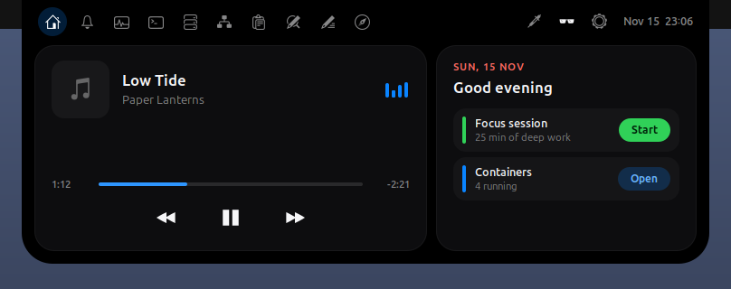
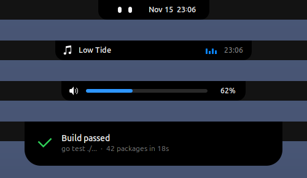
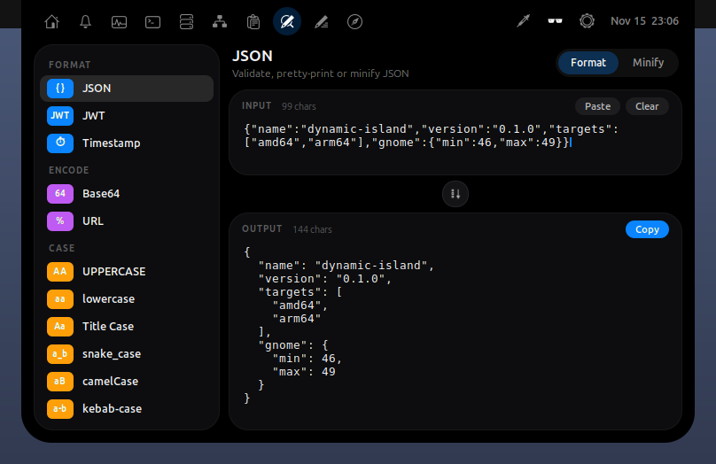
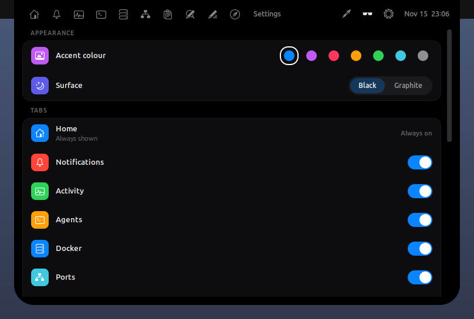

# Dynamic Island

[](https://github.com/AdamShannag/dynamic-island/actions/workflows/ci.yml)
[](https://github.com/AdamShannag/dynamic-island/releases)
[](LICENSE)

A Dynamic Island for the GNOME desktop on Ubuntu. It replaces the top-bar clock with a small pill. The pill grows to show what's happening: music, timers, notifications, finished builds, Claude Code sessions, volume changes. Click it to open a dashboard of everyday developer tools.

<p align="center">
  
</p>

<p align="center">
  
</p>

## Install

Ubuntu 24.04 or newer (GNOME Shell 46–50), x86-64 or ARM64:

```sh
curl -fsSL https://adamshannag.github.io/dynamic-island/setup.sh | sudo sh
sudo apt install dynamic-island
island setup
```

The first command adds the project's signed APT repository; after that, updates arrive through `sudo apt upgrade`. `island setup` runs as your user and starts the daemon and enables the extension. On Wayland, log out and back in once afterwards. On X11, press <kbd>Alt</kbd>+<kbd>F2</kbd>, type `r` and press Enter.

<details>
<summary>Other ways to install</summary>

**Add the repository by hand**

```sh
curl -fsSL https://adamshannag.github.io/dynamic-island/dynamic-island.gpg \
  | sudo tee /usr/share/keyrings/dynamic-island.gpg >/dev/null
echo "deb [signed-by=/usr/share/keyrings/dynamic-island.gpg] https://adamshannag.github.io/dynamic-island stable main" \
  | sudo tee /etc/apt/sources.list.d/dynamic-island.list
sudo apt update && sudo apt install dynamic-island
```

**A single .deb.** Download it from the [releases page](https://github.com/AdamShannag/dynamic-island/releases), then run `sudo apt install ./dynamic-island_<version>_amd64.deb`. This way it doesn't update automatically.

**Into your home directory, without root.** Unpack the release tarball (or clone the repo, which needs Go 1.22+) and run `./install.sh`. It installs to `~/.local`. `./uninstall.sh` removes it; add `--purge` to delete your data too.

</details>

To remove the package: `island setup --remove`, then `sudo apt remove dynamic-island`.

## Features

**The pill** shows one thing at a time, chosen by priority:

- **Clock:** the time, with two small eyes that follow your cursor. You can turn them off.
- **Music:** the playing track from any MPRIS player (Spotify, browsers, mpv).
- **Notifications:** from your apps. Clicking one opens the app, the same as clicking GNOME's banner.
- **Volume and brightness:** shown in the pill instead of GNOME's popup.
- **Timers and tasks:** a focus timer, and commands wrapped with `island run`.
- **Claude Code:** approval requests and finished turns.
- **Alerts:** battery, USB devices, and containers that crash or turn unhealthy.

**The dashboard** opens on click or from a keyboard shortcut:

| Tab | |
|---|---|
| Home | Now playing with controls, a focus timer, and a container summary |
| Notifications | Everything your apps sent while you were away. Kept in memory only. |
| Activity | CPU, memory, disk and network with live graphs; top processes; running builds, tests and dev servers with clickable ports |
| Agents | Claude Code sessions with their state, cost and context usage. Click one to jump to its terminal. |
| Docker | Containers grouped by Compose project, with health, live CPU and memory, logs, restart and stop |
| Ports | Every listening port and the process or container behind it. Free a port with two clicks. |
| Clipboard | Searchable history with pinning. Skips anything password managers flag as secret. |
| Transform | JSON, JWT, timestamps, Base64, URL encoding and case conversion, updated as you type |
| Notes | A small notes app with search, pinning and autosave |
| Web | Search or open a URL, a calculator (`150*1.16` ⏎ copies `174`), saved sites, and QR codes |

The header also has a colour picker and a **presentation mode**. Presentation mode hides track names, notifications, clipboard history and notes, and it turns on automatically while you share your screen. Tabs, features, the accent colour and the background are all set in **Settings**.

<p align="center">
  
  
</p>

## Usage

Left-click the pill to open the dashboard. Right-click it for GNOME's calendar menu. Press <kbd>Esc</kbd> or click outside to close.

To open the dashboard from the keyboard, add a custom shortcut in **Settings → Keyboard** that runs `island open` (or `island open notes`, `island open docker`, and so on).

```sh
island notify "Deployed" "prod is live"        # -a ok|warn|error  -i icon-name  -t ms
island run -- make test                        # live timer in the pill, then ✓ or ✗
island kill-port 8080                          # free a port
island pomodoro start
island claude install                          # report Claude Code sessions to the island
```

**Claude Code.** `island claude install` adds hooks and wraps your status line; it backs up `~/.claude/settings.json` first. The pill shows approval requests and finished turns, and the Agents tab lists every session. `island claude uninstall` removes exactly what was added.

**Long-running shell commands.** Source the bash hook and every command that runs longer than 15 seconds reports when it finishes:

```sh
echo 'source /usr/share/dynamic-island/island-hook.bash' >> ~/.bashrc
```

Set `ISLAND_MIN_SECS` to change the threshold and `ISLAND_IGNORE` (a regex) to skip commands.

## Configuration

Most options are in the dashboard under **Settings**. A few daemon options are in `~/.config/dynamic-island/config.json`; see [`config.example.json`](config.example.json):

```json
{
  "disable": ["docker"],
  "notifications": { "ignoreApps": ["Spotify"] },
  "pomodoro": { "focusMinutes": 25, "breakMinutes": 5 }
}
```

Restart the daemon after changing it: `systemctl --user restart dynamic-island`.

Your data stays on your machine, in `~/.local/share/dynamic-island`. The clipboard history, notes and saved sites are stored with owner-only permissions. Notifications are never written to disk.

## How it works

```
MPRIS, UPower, notifications, Docker, /proc, ss, CLI
        │
        ▼
dynamic-islandd  (Go)  ──── D-Bus ────►  GNOME Shell extension  (GJS)
plugins → priority queue → view            renders the pill and dashboard
```

The daemon does all the work. Plugins post activities with a priority and an optional lifetime, the highest-priority one becomes the current view, and the daemon publishes it on the session bus. The extension only draws what it receives and asks the daemon for dashboard data while a tab is open. That keeps GNOME Shell responsive: the daemon uses about 15 MB of memory and a fraction of a percent of one CPU core.

The D-Bus interface is documented in [docs/dbus-api.md](docs/dbus-api.md). Any script can drive the island through it.

## Compatibility

Only GNOME Shell 46 (Ubuntu 24.04) has actually been run. The extension declares support for 46–50 and uses the newer APIs where they changed, but 47–50 haven't been tested yet. X11 and Wayland both work on 46–49; GNOME Shell 50 dropped X11 entirely, so it's Wayland-only there. Docker is optional.

## Development

```sh
git clone https://github.com/AdamShannag/dynamic-island && cd dynamic-island
(cd extension && npm ci)      # dev tools for the extension checks (Node 22)
make check test               # gofmt, go vet, static checks, and the Go and JS tests
make install                  # build and install into ~/.local
make logs                     # follow the daemon's and GNOME Shell's logs
```

[CLAUDE.md](CLAUDE.md) covers the architecture, how to add a dashboard tab or a daemon plugin, how to test in a headless GNOME Shell, and the pitfalls that keep the shell at 60 fps. Read it before your first change. Releases are cut by pushing a `v*` tag. CI then builds the packages and publishes the APT repository.

## License

[MIT](LICENSE)
